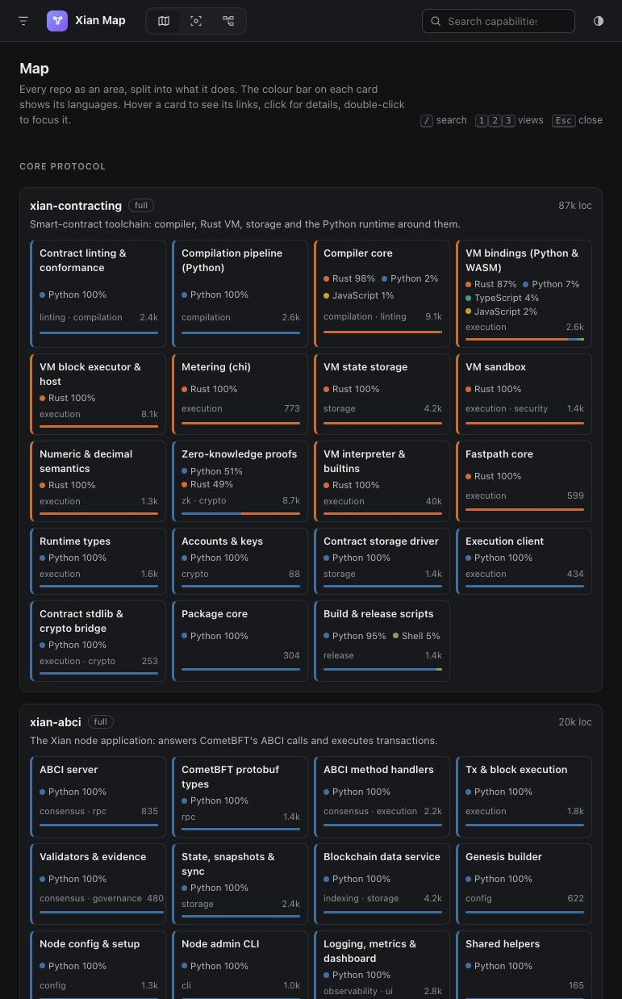
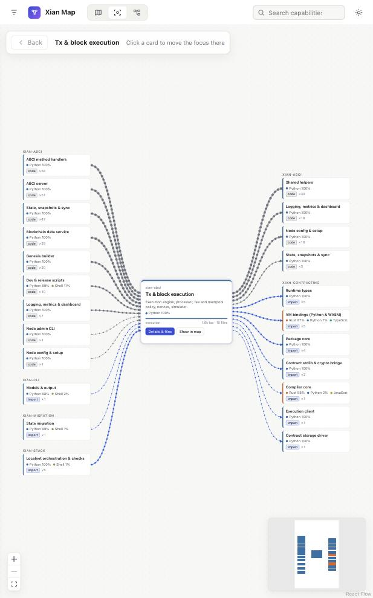
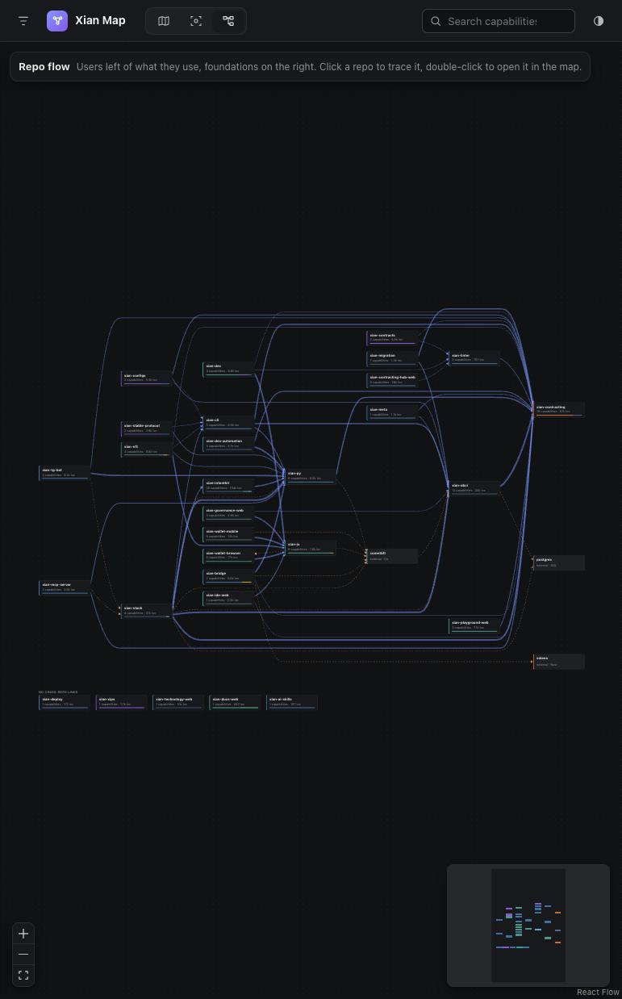
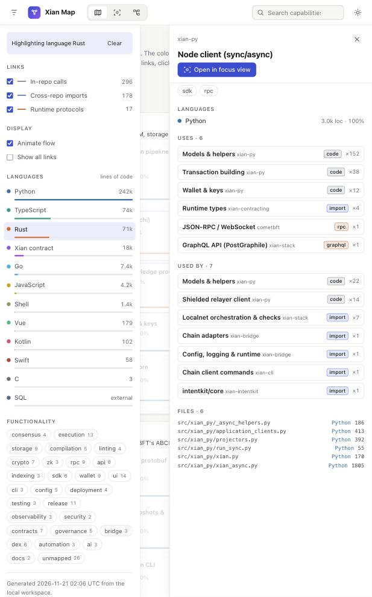

# Xian Map

An interactive map of the Xian codebase. It shows every repo in the workspace
as an area, splits each repo into what it actually does (execution, storage,
linting, RPC, …), shows which languages each part is written in, and draws how
the parts connect: calls inside a repo, imports between repos, and the runtime
protocols that tie the system together (ABCI, JSON-RPC, SQL, GraphQL, native
bindings).

The output is a single offline HTML page. One command builds it from the
sibling repos on disk; a second command tells you what has drifted.

**Live version:** https://endogen.github.io/xian-map/ (public repos only, see
[Publishing to GitHub Pages](#publishing-to-github-pages)).



## Contents

- [What you can do with it](#what-you-can-do-with-it)
- [Quick start](#quick-start)
- [How it works](#how-it-works)
- [Keeping the map up to date](#keeping-the-map-up-to-date)
- [Publishing to GitHub Pages](#publishing-to-github-pages)
- [capabilities.json reference](#capabilitiesjson-reference)
- [Changing the viewer or the generator](#changing-the-viewer-or-the-generator)
- [Limits](#limits)
- [Project layout](#project-layout)
- [Licenses](#licenses)

## What you can do with it

### Three views

| View | Shows | Use it to |
| --- | --- | --- |
| **Map** | Every repo as a card, grouped by category, with one tile per capability. Each tile shows its languages as text and as a colour bar. | Get the big picture; find where a piece of functionality lives and what language it is in. |
| **Focus** | One capability in the middle, everything that uses it on the left, everything it uses on the right. | Understand one part in depth and walk the system: click any side card to move the focus there. |
| **Repo flow** | All repos as a layered graph: repos that use others on the left, foundations (contracting, PostgreSQL, Solana) on the right. | See the dependency structure of the whole workspace and how a request travels. |

<table>
<tr>
<td></td>
<td></td>
</tr>
<tr><td align="center">Focus</td><td align="center">Repo flow</td></tr>
</table>

### Interactions

| Where | Action | Result |
| --- | --- | --- |
| Map | Hover a tile | Its links are drawn, unrelated tiles fade. |
| Map | Click a tile | The details panel opens: what the capability does and **why it's here**, languages with line counts, every incoming and outgoing link with file:line evidence, the file list and its repository. **View source** opens its folder on GitHub; every file and every file:line evidence row links to that line on GitHub. |
| Map | Double-click a tile | Opens it in Focus. |
| Focus | Click a side card | That capability becomes the centre; **Back** and the breadcrumb return. |
| Focus | Hover a side card | Highlights its wire. |
| Focus, Repo flow | Drag the background, scroll, use the controls or the minimap | Pan and zoom. |
| Focus, Repo flow | Drag a card | Moves it; the wires that touch it re-route live. The browser remembers where you put it (see [Your own arrangement](#your-own-arrangement)). |
| Focus, Repo flow | **Reset** in the chip at the bottom | Puts every card of that view back in its automatic place. |
| Repo flow | Click a repo | Animates its links and fades everything else; click the background to clear. |
| Repo flow | Double-click a repo | Opens it in the Map. |
| Sidebar | Tick or untick a link kind | Shows or hides in-repo calls, cross-repo imports, or runtime protocols in every view. |
| Sidebar | Click a language or a functionality tag | Turns on a lens and shows what it found right away, whatever was selected before: the biggest match becomes the selection (the Map scrolls to it, Focus puts it in the centre, with **Back** to where you were), and Repo flow zooms to fit every repo with a match. Matching capabilities stay highlighted in every view, and a list at the top of the sidebar shows all of them, biggest first (for a language: by lines in that language), e.g. "Rust · 11 capabilities in 2 repos · 71k lines of Rust". Click an entry to go there. In Repo flow, each repo card shows how much of the language it holds. Language and tag combine; **Clear** resets. |
| Sidebar | Animate flow / Show all links / Wire style | Turns the moving dots on or off, draws every link in the Map, switches Focus wires between curved and orthogonal. |
| Sidebar | **Reset all** under Display | Forgets the arrangement of every view. |
| Top bar | Search (<kbd>/</kbd>) | Lists ranked matches as you type: repos, capabilities, and files (shown with the capability that holds them). <kbd>↑</kbd> <kbd>↓</kbd> and <kbd>Enter</kbd>, or click, takes you there in the current view: the Map scrolls to it and opens its details, Focus puts it in the centre, Repo flow selects its repo and zooms in. |
| Top bar | Theme button | Cycles system, light and dark. |



### One selection across views

There is always one selected capability, and every view shows it: the Map
outlines its card, Focus puts it in the centre, Repo flow highlights its repo.
Switching views keeps it in sight (the Map scrolls to it, Repo flow zooms to
its repo). Clicking a repo in Repo flow selects the capability that stands for
it (the one you had selected, if it lives there, otherwise its most connected
one), so switching to Focus right after shows that repo's centre piece.

Keyboard: <kbd>/</kbd> search, <kbd>1</kbd> <kbd>2</kbd> <kbd>3</kbd> switch
views, <kbd>Esc</kbd> clears the search or closes the panel or drawer. The URL
remembers the view and the selected capability
(`#mode=focus&cap=xian-abci/execution`), so you can bookmark or share a
position.

### Your own arrangement

Cards you drag in Focus or Repo flow stay where you drop them, also after a
reload. Each view is kept on its own: Repo flow, and Focus once per centre
capability (and per set of link kinds, since those change the layout). Only
this browser keeps them (`localStorage`). Nothing is sent anywhere.

- A chip at the bottom of the canvas shows when a view is not in its automatic
  layout. **Your layout** means you moved cards. **Restored your layout**
  (pulsing once) means the arrangement came back from an earlier visit.
  **Layout not saved** means the browser blocks storage, so the arrangement is
  lost on reload.
- **Reset** in the chip resets that view. **Reset all** in the sidebar's
  Display section resets every view. The sidebar also says how many views
  are saved.
- A card goes back to its saved place only while the automatic layout still
  puts it where it was when you moved it. After a rebuild that changes the
  layout around a card, that card starts from its new automatic place instead
  of landing on top of new neighbours.
- At most 50 views are kept. The ones arranged longest ago are dropped first.

### Reading the map

- **Colours of a tile** are languages (Python, Rust, TypeScript, Xian
  contract, …). The left border is the main language, the bar at the bottom
  the full mix.
- **Wire colours** are link kinds: grey for calls inside a repo, blue for
  imports between repos, orange (dashed) for runtime protocols. The moving
  dots run from caller to callee.
- **Wire thickness** grows with the number of underlying calls or imports.
- **Dashed tiles** are source files that no capability claims yet; the map
  groups them by folder so nothing is hidden.
- **Dashed repos** (CometBFT, PostgreSQL, Solana) are outside the workspace
  but part of the runtime picture.

## Quick start

Requirements: Python 3.11+ and git. Node.js is only needed to run the layout
tests. Nothing is installed: the generator uses the standard library and the
page's libraries are vendored.

The map expects to sit next to the Xian repos, with `xian-meta` among them:

```
xian/                      # workspace root
├── xian-meta/             # provides workspace-repos.json (repo list, categories, tiers)
├── xian-abci/
├── xian-contracting/
├── …
└── xian-map/              # this repo
```

Build it:

```bash
cd xian-map
python3 build.py
```

It prints how much of each repo is mapped and writes `out/code-map.html`
(the page, about 2.5 MB) and `out/code-map.json` (the data). Open the page in
any browser, or serve it:

```bash
python3 -m http.server 8766 --directory out
```

then visit http://localhost:8766/code-map.html.

Options:

| Flag | Default | Meaning |
| --- | --- | --- |
| `--workspace-root` | parent of this repo | Folder that holds the sibling repos. |
| `--manifest` | `<workspace-root>/xian-meta/workspace-repos.json` | Repo list with categories and tiers. |
| `--taxonomy` | `capabilities.json` | The capability definitions. |
| `--out` | `out/` | Where the page and data go. |
| `--exclude REPO` | none | Leave a repo out, with every link that touches it (repeatable). |
| `--check` | off | Report drift instead of building (see below). |

## How it works

```
git ls-files (each repo)          capabilities.json            graphify-out/graph.json (each repo)
        │                                │                                │
        ▼                                ▼                                ▼
  source files ──► assign each file to the first matching capability ──► calls/imports between capabilities
        │                                                                 ("in-repo calls")
        ├─► language from the extension, lines of code
        └─► Python and JS/TS imports that cross repos ──────────────────► "cross-repo imports"
                                capabilities.json "links" ──────────────► "runtime protocols"
                                                │
                                                ▼
                          out/code-map.json + viewer/index.html ──► out/code-map.html
```

1. **Files.** `git ls-files` lists each repo's tracked files. Tests, vendored
   code, docs, examples, build output and `conftest.py` are skipped. The
   language comes from the extension; Python files in a capability marked
   `"contract": true` count as **Xian contract**.
2. **Capabilities.** Each file goes to the first capability in
   `capabilities.json` whose `paths` glob matches it. Unmatched files are
   grouped by their first two folders and tagged `unmapped`.
3. **In-repo calls** come from each repo's
   [graphify](https://github.com/Graphify-Labs/graphify) graph
   (`graphify-out/graph.json`): every `calls`, `imports`, `inherits`, … link
   between files of two different capabilities counts once, with file:line
   evidence.
4. **Cross-repo imports** are parsed directly: Python imports (via `ast`)
   resolve against package-rooted modules that only one repo defines; JS/TS
   imports resolve against the `name` of each repo's `package.json` files.
5. **Runtime protocols** are the `links` in `capabilities.json`, because no
   import shows that a wallet talks to CometBFT over JSON-RPC.
6. **The page.** `build.py` inlines the data, `viewer/layout.js` and the
   vendored libraries into `viewer/index.html`. Focus and Repo flow use
   [React Flow](https://reactflow.dev) for the canvas.
   - **Focus layout:** `layout.js` places the three columns and routes the
     wires. Ports are ordered by the far end of each wire, so curves fan out
     without crossing (and orthogonal lanes are assigned so they never cross).
   - **Repo flow layout:** [ELK](https://eclipse.dev/elk/) (layered algorithm:
     longest-path layering so foundations share the last column,
     Brandes-Köpf placement, spline routing around cards). Cycles are cut
     first by our own greedy feedback-arc-set step, which cuts the lightest
     link of a cycle, and ELK lays out the rest.
7. **Source links.** Each repo's GitHub address comes from its `origin`
   remote. Only `github.com` remotes are used, and any credentials in them are
   dropped. A capability's **View source** opens the folder its files share
   (or its only file) on the default branch. File and evidence links carry line
   numbers, which are only right at one commit, so they point at the newest
   commit the repo shares with its upstream: HEAD once pushed, never a local
   commit GitHub doesn't have. External systems link to the `url` in
   `capabilities.json`.

## Keeping the map up to date

The map is regenerated from the code, so most changes need nothing but a
rebuild. Only `capabilities.json` is hand-written, and the check tells you
exactly when it needs attention.

### Routine

```bash
cd xian-map
python3 build.py --check   # what drifted? exits 1 if anything did
python3 build.py           # rebuild the page
```

### Fixing what `--check` reports

| Finding | Meaning | Fix |
| --- | --- | --- |
| `<repo>: N source files in no capability, e.g. <path>` | New files that no capability's `paths` match. | Add a glob to the capability they belong to, or add a new capability. Order matters: put specific globs before catch-alls like `"src/*"`. |
| `<repo>: capability <id> matches no files` | Its folder moved, was renamed or deleted, or an earlier capability now catches the files. | Fix or remove the `paths`, or reorder the capabilities. |
| `<repo>: not listed in capabilities.json` | A repo appeared in the workspace manifest. | Add it under `repos`: with capabilities, or with `"capabilities": []` to keep it grouped by folder on purpose. |
| `<repo>: graphify graph was built at X, the repo is at Y` | The in-repo call links are older than the code. | From the workspace root: `python3 xian-meta/scripts/graphify_workspace.py refresh --repo <repo>` (omit `--repo` for all). |
| `<repo>: no graphify graph` | The repo has never been indexed. | Run graphify in that repo (see `xian-meta/docs/CODE_GRAPH_WORKFLOW.md`). |
| `<repo>: capability <id> has no summary or purpose` | The details panel can't say what it does or why it exists. | Add a one-sentence `summary` (what it does) and `purpose` (why the system needs it). Read the code first; don't guess. |

Repos that the workspace manifest marks `exempt` (such as `xian-intentkit`)
are not held to graph freshness, because the refresh helper skips them.

### Adding a runtime link

Imports are found automatically; runtime protocols are not. When two parts
talk over a network, a socket, a database or a native binding:

1. Find the evidence in the source, for example
   `grep -rn "broadcast_tx\|abci_query" <repo>/src`.
2. Add an entry to `links` with the two capability ids, a `kind` (`rpc`,
   `abci`, `sql`, `graphql`, `native`, `postMessage`, `runs`, … any short
   word) and a `label` that says what flows.
3. Run `python3 build.py` and check the link in Focus.

### Adding or splitting a capability

1. Pick a short `id`, a human `name`, a one-line `summary`, and `tags` from
   the `tags` list at the top of `capabilities.json` (add a tag there first if
   none fits).
2. Write `paths` globs. Run `python3 build.py`: the summary line for that
   repo should still say `100.0% mapped`, and `--check` should be clean.

### Asking an agent to do it

No special skill is needed. Point an agent at this repo and ask it to "update
the map": `AGENTS.md` sends it to this section, `--check` tells it what to
change, and the tests tell it when it is done.

## Publishing to GitHub Pages

The live site is the `gh-pages` branch of this repo. GitHub cannot build it,
because the build needs the sibling repos and their local graphify graphs, so
it is published from a machine that has the workspace:

```bash
cd xian-map
python3 build.py --check          # optional: make sure the map is current
scripts/publish-pages.sh
```

The script asks GitHub (via `gh`) which workspace repos are public, builds the
page **without every repo that is not public** (`--exclude`), and force-pushes
it as the only commit of `gh-pages`. Pages serves it at
https://endogen.github.io/xian-map/ a minute later. It needs `git`, `python3`
and an authenticated `gh`.

Private repos are only left out of the published page. The local build
(`python3 build.py`) still shows everything, and `capabilities.json` in this
repo describes all repos, so keep private repos' entries free of anything
that must not be public.

## capabilities.json reference

```jsonc
{
  "tags": ["execution", "storage", "linting", "..."],   // allowed tags; anything else is rejected
  "repos": {
    "xian-abci": {
      "summary": "One sentence shown on the repo card.",
      "capabilities": [
        {
          "id": "execution",                  // unique within the repo; full id is "xian-abci/execution"
          "name": "Tx & block execution",
          "summary": "What it does, one sentence.",
          "purpose": "Why the system needs it, one sentence.",
          "tags": ["execution"],
          "paths": ["src/xian/execution_engine.py", "src/xian/processor.py"],
          "contract": false                    // true: count .py files as Xian contracts
        }
      ]
    },
    "cometbft": {
      "summary": "Outside the workspace, shown for the runtime picture.",
      "external": true,                         // no files; capabilities name their languages instead
      "url": "https://github.com/cometbft/cometbft",  // optional project page; must be https
      "capabilities": [{ "id": "rpc", "name": "JSON-RPC", "tags": ["rpc"], "languages": ["Go"] }]
    },
    "xian-intentkit": { "summary": "…", "capabilities": [] }  // empty list: grouped by folder on purpose
  },
  "links": [
    { "from": "xian-py/client", "to": "cometbft/rpc", "kind": "rpc", "label": "JSON-RPC broadcast_tx / abci_query" }
  ]
}
```

Rules, all enforced when the file is loaded:

- `paths` are `fnmatch` globs relative to the repo root, and `*` also matches
  `/`, so `"src/xian/methods/*"` covers every file below that folder. The
  first capability that matches a file wins.
- Every capability needs `paths`, except in `external` repos, where it needs
  `languages` instead.
- Capability ids are unique, tags must come from `tags`, and `links` must name
  existing capability ids.
- An external repo's `url` must start with `https://`.

`summary` and `purpose` are not enforced at load time, but `--check` reports
every capability that lacks either one.

## Changing the viewer or the generator

| File | What it does |
| --- | --- |
| `build.py` | The generator and `--check` (Python standard library only). |
| `viewer/index.html` | The page: layout, styles, the Map view, sidebar, details panel, and the React Flow canvases. |
| `viewer/layout.js` | Pure, tested logic: search ranking, language and tag lenses, focus columns, repo links, cycle cutting, ELK input and output, wire routing (ports, curves, orthogonal lanes), and which saved card positions to keep and restore. |
| `viewer/vendor/` | React, React Flow and ELK browser builds (see its README for versions and updating). |
| `tests/test_build.py` | Generator and check tests, including a full build of a fake two-repo workspace. |
| `tests/layout.test.cjs` | Layout and routing tests, including a run of the real ELK. |

Run all tests (the Python suite also runs the Node tests when `node` is
installed):

```bash
python3 -m unittest discover -s tests
node --preserve-symlinks --preserve-symlinks-main --test tests/layout.test.cjs   # layout tests alone
```

CI runs the same on every push to `main` and on pull requests.

Code quality is checked with [crapper](https://github.com/unclebob/crapper)
(CRAP score under 10 per function), [dryer](https://github.com/unclebob/dryer)
(no structural duplication) and [mutator](https://github.com/unclebob/mutator)
(mutation testing):

```bash
crapper --threshold 10 --coverage-command "python3 -m coverage run --source=. -m unittest discover -s tests && mkdir -p coverage && python3 -m coverage lcov -o coverage/lcov.info" build.py
crapper --threshold 10 --coverage-command "mkdir -p coverage && node --preserve-symlinks --preserve-symlinks-main --experimental-test-coverage --test-reporter=lcov --test-reporter-destination=coverage/lcov.info --test tests/layout.test.cjs" viewer/layout.js
mutator --reuse-coverage --test-command "python3 -m unittest discover -s tests" build.py
mutator --reuse-coverage --test-command "node --preserve-symlinks --preserve-symlinks-main --test tests/layout.test.cjs" viewer/layout.js
dryer build.py
rm -rf .metrics coverage .coverage target   # tool output, not committed
```

`--preserve-symlinks` matters: mutator runs tests from a symlink overlay, and
without it Node would load the unmutated file. All of `build.py`'s mutants are
killed; the few that survive in `layout.js` cannot change any result (constant
offsets, comparisons between values that are never equal).

## Limits

- A missing link does not prove there is no dependency. Dynamic imports,
  string-built module names, and network calls without a curated link are
  invisible.
- In-repo calls are only as fresh as each repo's graphify graph; `--check`
  reports stale ones.
- Cross-repo Python imports only count for packages that exactly one repo
  defines, so that a shared module name is never guessed.
- `xian-intentkit` is an exempt fork and is grouped by folder, not described.
- The page is about 2.5 MB because everything is inlined. Some embedded
  browsers refuse to open a file that large directly; serve it with
  `python3 -m http.server` instead.

## Project layout

```
xian-map/
├── build.py                 # generator and drift check
├── capabilities.json        # the hand-written part: capabilities, tags, runtime links
├── viewer/
│   ├── index.html           # page template
│   ├── layout.js            # tested layout and routing logic
│   └── vendor/              # React, React Flow, ELK (+ licenses)
├── scripts/
│   └── publish-pages.sh     # build without private repos, push to gh-pages
├── tests/
│   ├── test_build.py
│   └── layout.test.cjs
├── docs/                    # screenshots for this README
├── .github/workflows/ci.yml
├── LICENSE                  # MIT
└── out/                     # generated, git-ignored
```

## Licenses

This repository is MIT licensed (see `LICENSE`). The vendored libraries keep
their own licenses: React and React Flow are MIT, ELK (`elkjs`) is EPL-2.0 or
GPL-3.0-or-later. See `viewer/vendor/README.md`.
